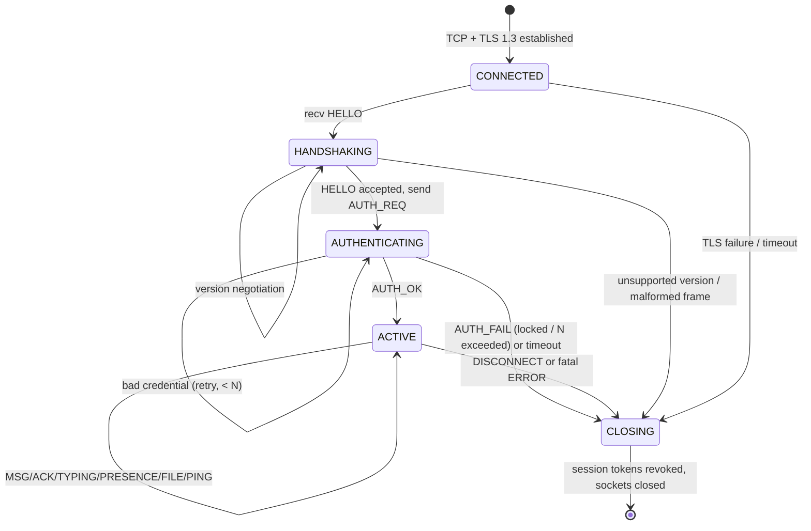

# CSCP — Campus Secure Comm Protocol

**Version:** 1.0 · **Layer:** OSI Layer 7 (Application) over TLS 1.3 (L5/L6) over TCP (L4) over IP (L3)

CSCP is a custom binary application-layer protocol for secure campus messaging
and file sharing. It runs inside a TLS 1.3 session and provides framing,
message typing, sequencing, integrity, version negotiation, and reliable
transfer primitives on top of TCP's byte stream.

---

## 1. Why a custom protocol?

TCP gives us an *ordered, reliable byte stream* — not messages. An application
must impose its own **message boundaries**. CSCP uses **length-delimited
framing** with a fixed-size header, the same approach as TLS records, HTTP/2
frames, gRPC messages and WebSocket frames. This solves the two fundamental
stream problems:

| Problem | Cause | CSCP solution |
|---|---|---|
| **Partial read** | One `recv()` returns less than a full frame | Buffer bytes; emit only when the header's length field is satisfied |
| **Coalesced read** | One `recv()` returns several frames joined | `FrameDecoder` loops and emits each complete frame individually |

> *Viva:* "TCP is a stream, so I implemented an incremental length-delimited
> parser (`FrameDecoder`) that is correct under arbitrary segmentation of the
> stream — exactly what a real protocol stack does."

---

## 2. Frame format

All multi-byte integers are **big-endian (network byte order)**. Header = 20 B,
trailer = 4 B, so per-frame overhead = **24 B**.

```
 0                   1                   2                   3
 0 1 2 3 4 5 6 7 8 9 0 1 2 3 4 5 6 7 8 9 0 1 2 3 4 5 6 7 8 9 0 1
+-+-+-+-+-+-+-+-+-+-+-+-+-+-+-+-+-+-+-+-+-+-+-+-+-+-+-+-+-+-+-+-+
|                                                               |
+                       MAGIC  ('CSCP' = 0x43534350)           +  bytes 0-3
|                             4 bytes                           |
+-+-+-+-+-+-+-+-+-+-+-+-+-+-+-+-+-+-+-+-+-+-+-+-+-+-+-+-+-+-+-+-+
|   VERSION     |   MSG TYPE    |            FLAGS              |  bytes 4-7
|    1 byte     |    1 byte     |           2 bytes             |
+-+-+-+-+-+-+-+-+-+-+-+-+-+-+-+-+-+-+-+-+-+-+-+-+-+-+-+-+-+-+-+-+
|                    PAYLOAD LENGTH (uint32)                    |  bytes 8-11
|                          4 bytes                              |
+-+-+-+-+-+-+-+-+-+-+-+-+-+-+-+-+-+-+-+-+-+-+-+-+-+-+-+-+-+-+-+-+
|                                                               |
+                 SEQUENCE NUMBER (uint64)                      +  bytes 12-19
|                          8 bytes                              |
+-+-+-+-+-+-+-+-+-+-+-+-+-+-+-+-+-+-+-+-+-+-+-+-+-+-+-+-+-+-+-+-+
|                                                               |
~                         PAYLOAD (L bytes)                     ~
|                                                               |
+-+-+-+-+-+-+-+-+-+-+-+-+-+-+-+-+-+-+-+-+-+-+-+-+-+-+-+-+-+-+-+-+
|                       CRC32 (header || payload)               |  trailer, 4 B
+-+-+-+-+-+-+-+-+-+-+-+-+-+-+-+-+-+-+-+-+-+-+-+-+-+-+-+-+-+-+-+-+
```

| Field | Size | Purpose |
|---|---|---|
| Magic | 4 B | Frame sync / protocol identification (`CSCP`) |
| Version | 1 B | Protocol version (negotiated in `HELLO`) |
| Msg type | 1 B | `MessageType` enum (see §4) |
| Flags | 2 B | `FrameFlags` bitfield (see §5) |
| Payload length | 4 B | Length of payload only; enables framing + DoS guard |
| Sequence | 8 B | Per-connection monotonic counter for ordering, ACKs, replay defence |
| Payload | L B | MessagePack map (or raw E2EE ciphertext for `ENCRYPTED`) |
| CRC32 | 4 B | Integrity over `header || payload` |

### CRC scope

```
crc = CRC32( header_bytes || payload_bytes )
```

CRC32 is an **error-detecting** code (integrity against corruption/accidental
mutation), *not* a cryptographic MAC. Authenticity and confidentiality come from
TLS 1.3 and, for E2EE payloads, AES-256-GCM. CRC is deliberately cheap so it can
run on every frame in the event loop.

### Limits

* `MAX_FRAME_SIZE = 16 MiB` (configurable). The decoder rejects any advertised
  length above the cap **before buffering** — defence against a peer that
  claims a 4 GiB payload to exhaust memory.
* File data uses **64 KiB chunks** (`FILE_CHUNK_SIZE`), far below the cap, to
  keep latency low and enable windowed flow control.

---

## 3. Stream decoding algorithm

```
loop:
    if buffered < HEADER_SIZE: return (need more bytes)
    parse header
    if magic != 'CSCP':            raise MagicMismatchError   # desync
    if payload_len > MAX_FRAME_SIZE: raise FrameTooLargeError
    total = HEADER_SIZE + payload_len + TRAILER_SIZE
    if buffered < total:           return (need more bytes)  # partial frame
    verify CRC32
    consume `total` bytes
    emit Frame
```

`FrameDecoder.feed(data)` appends bytes; `next_frame()` returns one frame or
`None`. Coalesced input is drained by calling until `None`.

---

## 4. Message types

Grouped by high nibble so a receiver can classify cheaply.

| Group | Code | Name | Direction | Payload summary |
|---|---|---|---|---|
| Handshake | `0x01` | `HELLO` | C→S | versions, client_id, nonce, capabilities |
| | `0x02` | `AUTH_REQ` | C→S | username, method, credential, device_id |
| | `0x03` | `AUTH_OK` | S→C | user_id, access/session tokens, server_time |
| | `0x04` | `AUTH_FAIL` | S→C | reason, attempts_remaining, locked_until |
| Messaging | `0x10` | `MSG_DIRECT` | C↔S | E2EE ciphertext 1:1 |
| | `0x11` | `MSG_GROUP` | C↔S | E2EE ciphertext to a channel |
| | `0x12` | `ACK` | C↔S | ack_seq, msg_id, delivery status |
| | `0x13` | `TYPING` | C↔S | scope, target, typing state |
| | `0x14` | `PRESENCE` | C↔S | user_id, state, last_seen |
| File | `0x20` | `FILE_OFFER` | C↔S | name, size, sha256, mime, wrapped_key |
| | `0x21` | `FILE_ACCEPT` | C↔S | accepted, resume offset |
| | `0x22` | `FILE_CHUNK` | C↔S | transfer_id, index, encrypted data |
| | `0x23` | `FILE_DONE` | C↔S | whole-file sha256, size |
| | `0x24` | `FILE_RESUME` | C↔S | last_ack_index, last_ack_offset |
| Keepalive | `0x30` | `PING` | C↔S | ts, nonce |
| | `0x31` | `PONG` | C↔S | echoed ts/nonce, server_ts |
| Lifecycle | `0x40` | `ERROR` | S→C | code, message, fatal |
| | `0x41` | `DISCONNECT` | C↔S | reason, code |

---

## 5. Flags (16-bit bitfield)

| Bit | Name | Meaning |
|---|---|---|
| 0 | `COMPRESSED` | Payload is zlib-compressed |
| 1 | `ENCRYPTED` | Payload is E2EE ciphertext; server relays opaquely |
| 2 | `ACK_REQUESTED` | Receiver must send `ACK` for this sequence |
| 3 | `FINAL` | Last frame of a logical sequence |
| 4 | `RESUMED` | Part of a resumed transfer |
| 5 | `URGENT` | QoS: prioritise ahead of bulk file chunks |
| 6 | `RESPONSE` | Reply to an earlier request |

---

## 6. Version negotiation

1. Client sends `HELLO` listing `versions` it supports (e.g. `[2, 1]`) and a
   random `nonce` (for key-confirmation / anti-replay).
2. Server selects the **highest common** version and answers with an
   appropriate `AUTH_OK`/`ERROR(UNSUPPORTED_VERSION)`.
3. All subsequent frames use the negotiated version. The decoder can run in
   `strict_version` mode to reject mismatches.

This lets a new server keep serving old clients (backward compatibility) while
new clients get new features.

---

## 7. Protocol state machine

The connection progresses through an explicit finite-state machine (also
mirrored server-side by `server.session.SessionState`):



Sequence for a happy path:

```
Client                                   Server
  |------ HELLO (versions=[1], nonce) --->|
  |<----- HELLO-ack / ERROR if no match --|
  |------ AUTH_REQ (password/token) ----->|
  |<----- AUTH_OK (token, session_token)--|
  |====== ACTIVE: MSG_DIRECT / ACK =======|
  |------ PING ------------------------->|
  |<----- PONG ---------------------------|
  |------ DISCONNECT -------------------->|
```

---

## 8. Reliability primitives

* **Sequence numbers** give a *total order per connection* and let the peer ACK
  specific frames; gaps trigger retransmission.
* **ACK / de-duplication** — every message carries a `msg_id` (UUID); receivers
  drop duplicates by id, so retransmission after a lost ACK is safe
  (at-least-once delivery + idempotent apply = effectively-once).
* **FILE_* sliding window** — chunks are pipelined up to a window; selective
  ACKs let only missing chunks be retransmitted; `FILE_RESUME` continues after a
  drop.
* **Replay protection** — the server rejects a `sequence` it has already seen on
  a connection, and higher layers check message timestamps within a skew window.

---

## 9. Security layering

```
Application payload (MSG_DIRECT.ciphertext)
   │  AES-256-GCM (E2EE, end-to-end; server sees ciphertext only)
   ▼
CSCP frame (header + payload + CRC32)
   │  TLS 1.3 record encryption (server sees plaintext frames)
   ▼
TCP / IP
```

Defence in depth: CRC (accidental errors) → TLS 1.3 AEAD (in-transit) →
E2EE AEAD (end-to-end). See `security/threat_model.md` for the STRIDE analysis.

---

## 10. Reference implementation

| Concern | Module |
|---|---|
| Constants, types, flags | `protocol/constants.py` |
| Framing / decoder | `protocol/codec.py` |
| Messages & serialization | `protocol/messages.py` |
| Errors | `protocol/errors.py` |

Tests: `tests/protocol/` (boundaries, malformed, oversized, truncated,
coalesced, replay, and Hypothesis fuzzing).
